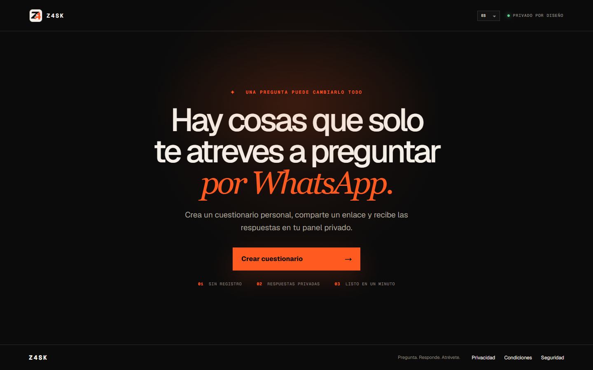
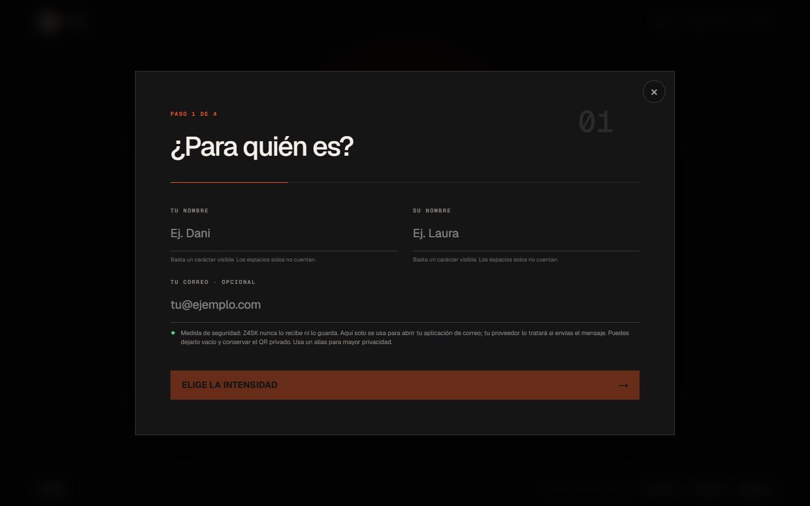

# Z4SK

[English](README.md) · [Español](README.es.md) · [Aplicación publicada](https://z4sk.vercel.app)

**Pregunta. Responde. Atrévete.** Z4SK es una aplicación móvil para crear cuestionarios privados. La persona creadora prepara una invitación, comparte el enlace público y consulta las respuestas cifradas desde un enlace secreto diferente.



## Por qué Z4SK

- No requiere registro ni cuenta.
- Las invitaciones caducan a las 12, 24, 48 o 72 horas.
- El modo de lectura única elimina el grafo activo de la invitación antes de devolver la única copia del texto cifrado.
- Las respuestas se cifran en el navegador del destinatario con ECDH P-256, HKDF-SHA-256 y AES-256-GCM.
- La clave privada de descifrado permanece en el fragmento del enlace secreto o en el QR privado; nunca se envía a la API.
- Cada destinatario recibe un enlace independiente para borrar su propia respuesta.
- El interés a doble ciego solo revela una coincidencia cuando ambas personas aceptan.
- El reto opcional de 30 segundos utiliza plazos absolutos, avance automático y no permite volver atrás.
- Incluye trece bibliotecas de idiomas y un modo legible por máquinas.

## Recorrido del producto

El constructor de cuatro pasos solicita únicamente la información necesaria para crear la invitación. El correo opcional permanece en el navegador y solo se utiliza para abrir la aplicación de correo del dispositivo.



El flujo principal es:

```text
Navegador del creador
  -> genera el token y el par de claves ECDH
  -> envía el hash del token, la clave pública y los datos de la invitación
  -> comparte /g/:id#verify=<huella-de-clave-pública>

Navegador del destinatario
  -> verifica la clave pública fijada en el enlace
  -> cifra localmente toda la respuesta privada
  -> guarda el texto cifrado mediante POST /api/games/:id/responses

Navegador del creador
  -> abre /p/:id#key=<bearer>&decrypt=<clave-privada>
  -> descarga el texto cifrado usando el token bearer
  -> descifra la respuesta localmente
```

## Tecnología

- Next.js App Router, React y TypeScript
- Vercel Functions y Vercel Cron
- Neon Postgres mediante `@neondatabase/serverless`
- Web Crypto para cifrado autenticado en el cliente
- PWA instalable con una caché del service worker deliberadamente limitada
- Cliente reutilizable e independiente del framework en `packages/z4sk-sdk`

## Desarrollo local

Requisitos: Node.js 22.13 o posterior y una cadena de conexión de Neon/Postgres.

```bash
npm install
cp .env.example .env.local
npm run dev
```

Abre `http://localhost:3000`. En desarrollo local, la clave del panel del fundador usa `dev-founder`; producción debe utilizar un `FOUNDER_DASHBOARD_KEY` largo y aleatorio.

## Verificación

El control habitual compila la aplicación, valida el HTML renderizado y audita las dependencias de producción:

```bash
npm run lint
npm test
npm audit --omit=dev
```

La verificación de staging crea o reutiliza una base independiente llamada `z4sk_staging_e2e` en el mismo proyecto de Neon. Inicia la aplicación compilada contra esa base y comprueba creación, cifrado, envíos concurrentes en lectura única, descifrado, borrado por el destinatario y caducidad exacta:

```bash
npm run verify:e2e:staging
```

La aplicación y el verificador nunca apuntan a la base de producción durante esta prueba. El rol de `DATABASE_URL` debe poder crear la base aislada.

## Límites de privacidad y seguridad

Z4SK evita que el texto de las respuestas llegue a su API o base de datos, pero una invitación no es completamente anónima. Los nombres visibles, preguntas seleccionadas, ajustes, fechas y metadatos de las solicitudes siguen siendo visibles para el servicio. Cualquiera que posea el enlace completo del creador puede descifrar las respuestas. Un navegador, dispositivo, extensión, despliegue o captura comprometidos pueden revelar el contenido.

Revisa [SECURITY.md](SECURITY.md) antes de una publicación abierta. El endpoint [`/api/privacy-proof`](https://z4sk.vercel.app/api/privacy-proof) publica evidencias de cifrado, retención y configuración; es una autoauditoría, no una certificación independiente.

## Mapa del repositorio

| Ruta | Responsabilidad |
| --- | --- |
| `app/components/Builder.tsx` | Asistente de creación del cuestionario |
| `app/g/[id]` | Experiencia pública del destinatario |
| `app/p/[id]` | Panel secreto del creador |
| `app/cancel/[id]` | Borrado de la respuesta por su destinatario |
| `app/api` | APIs de invitaciones, respuestas, retención, métricas y patrocinio |
| `app/lib/response-crypto.ts` | Cifrado y descifrado en el navegador |
| `db/runtime.ts` | Inicialización del esquema, consultas y purgado de Neon |
| `scripts/verify-e2ee.mjs` | Verificador completo del flujo cifrado |
| `packages/z4sk-sdk` | SDK reutilizable e independiente del framework |

## Despliegue

La rama `main` está conectada a Vercel. Producción utiliza funciones de Next.js y Neon Postgres. Cada versión debe poder reproducirse desde un commit limpio y superar todas las verificaciones antes de promocionarse.

```bash
vercel --prod
```

Consulta [docs/DEPLOYMENT.md](docs/DEPLOYMENT.md) para configurar variables, revertir versiones y realizar comprobaciones posteriores al despliegue.

## Documentación adicional

- [Producto y modelo de crecimiento](docs/PRODUCT.md)
- [Arquitectura y modelo de datos](docs/ARCHITECTURE.md)
- [Despliegue y rollback en Vercel](docs/DEPLOYMENT.md)
- [Operaciones y respuesta a incidentes](docs/OPERATIONS.md)
- [Seguridad, privacidad y modelo de amenazas](SECURITY.md)
- [Hoja de ruta comercial](docs/ROADMAP.md)
- [Marca y activación del dominio](docs/BRAND.md)
- [Registro de activos comercializables](SELLABLE_ASSETS.md)

## Estado del proyecto

Z4SK se encuentra en beta privada. Los pagos, notificaciones push y la integración con WhatsApp Business continúan desactivados. El acceso del creador depende de conservar el enlace secreto o el QR privado y, deliberadamente, no existe recuperación desde el servidor.

Actualmente no se concede ninguna licencia de código abierto. El repositorio y sus activos comerciales siguen siendo propietarios salvo que el titular publique una licencia independiente.
