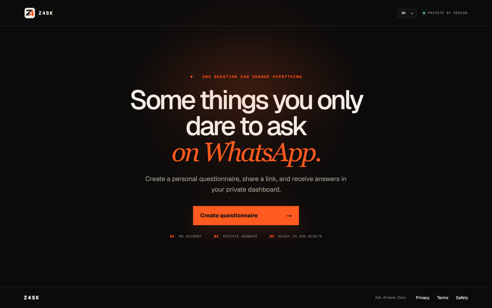
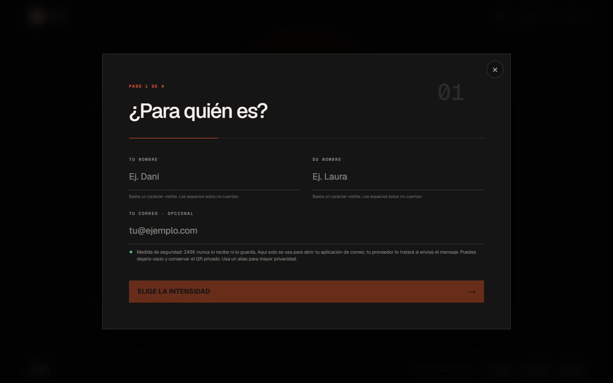

# Z4SK

[English](README.md) · [Español](README.es.md) · [Live application](https://z4sk.vercel.app)

**Ask. Answer. Dare.** Z4SK is an English-first, mobile-first private questionnaire app. A creator prepares an invitation, shares the public link, and reads encrypted responses through a separate secret dashboard link.



## Why Z4SK

- No account is required.
- Invitations expire after 12, 24, 48 or 72 hours.
- Optional view-once mode removes the active invitation graph before returning the only ciphertext read.
- Responses are encrypted in the recipient browser with ECDH P-256, HKDF-SHA-256 and AES-256-GCM.
- The creator's private decryption key remains in the secret URL fragment or private QR; it is never sent to the API.
- A recipient receives a separate deletion link for their own response.
- Double-blind interest matching reveals a match only when both people opt in.
- The optional 30-second challenge uses absolute deadlines, automatic advance and no backtracking.
- Thirteen language and machine-readable question libraries are included.

## Product tour

The four-step builder collects only what is needed to create the invitation. The optional email address stays in the browser and is used only to open the device mail application.



The core journey is:

```text
Creator browser
  -> generates creator token + ECDH key pair
  -> sends token hash + public key + invitation metadata
  -> shares /g/:id#verify=<public-key-fingerprint>

Recipient browser
  -> verifies the pinned public key
  -> encrypts the complete private response locally
  -> stores ciphertext through POST /api/games/:id/responses

Creator browser
  -> opens /p/:id#key=<bearer>&decrypt=<private-key>
  -> downloads ciphertext with the bearer token
  -> decrypts the response locally
```

## Technology

- Next.js App Router, React and TypeScript
- Vercel Functions and Vercel Cron
- Neon Postgres through `@neondatabase/serverless`
- Web Crypto for client-side authenticated encryption
- Installable PWA with an intentionally restricted service-worker cache
- Framework-neutral client in `packages/z4sk-sdk`

## Local development

Requirements: Node.js 22.13 or newer and a Neon/Postgres connection string.

```bash
npm install
cp .env.example .env.local
npm run dev
```

Open `http://localhost:3000`. In local development the founder dashboard key defaults to `dev-founder`; production must use a long random `FOUNDER_DASHBOARD_KEY`.

## Verification

The standard quality gate builds the production bundle, checks rendered output and runs a production-dependency audit:

```bash
npm run lint
npm test
npm audit --omit=dev
```

The staging verification creates or reuses a dedicated `z4sk_staging_e2e` database in the same Neon project, starts the built app against that database, exercises creation, encryption, concurrent view-once submission, decryption, recipient deletion and exact expiry, and then stops the local server:

```bash
npm run verify:e2e:staging
```

It never points the application or verifier at the production database. The database role in `DATABASE_URL` must be allowed to create the isolated staging database.

## Privacy and security boundaries

Z4SK keeps answer plaintext out of its API and database, but this does not make every part of an invitation anonymous. Display names, selected questions, settings, timestamps and request metadata remain visible to the service. Anyone with the complete creator link can decrypt responses. A compromised browser, device, extension, deployment or screenshot can reveal plaintext.

Review [SECURITY.md](SECURITY.md) before running a public deployment. The live [`/api/privacy-proof`](https://z4sk.vercel.app/api/privacy-proof) endpoint reports runtime retention, encryption and configuration evidence; it is a self-audit, not an independent certification.

## Repository map

| Path | Responsibility |
| --- | --- |
| `app/components/Builder.tsx` | Creator questionnaire wizard |
| `app/g/[id]` | Public recipient experience |
| `app/p/[id]` | Secret creator dashboard |
| `app/cancel/[id]` | Recipient-owned response deletion |
| `app/api` | Invitation, response, retention, metrics and sponsor APIs |
| `app/lib/response-crypto.ts` | Browser encryption and decryption |
| `db/runtime.ts` | Neon schema initialization, queries and purge operations |
| `scripts/verify-e2ee.mjs` | Full encrypted data-flow verifier |
| `packages/z4sk-sdk` | Reusable framework-neutral SDK |

## Deployment

`main` is connected to Vercel. Production uses Next.js Functions backed by Neon Postgres. Every release should be reproducible from a clean commit and pass the verification commands above before promotion.

```bash
vercel --prod
```

See [docs/DEPLOYMENT.md](docs/DEPLOYMENT.md) for environment setup, rollback and post-deploy checks.

## Further documentation

- [Product and growth model](docs/PRODUCT.md)
- [System architecture and data model](docs/ARCHITECTURE.md)
- [Vercel deployment and rollback](docs/DEPLOYMENT.md)
- [Operations and incident runbook](docs/OPERATIONS.md)
- [Security, privacy and threat model](SECURITY.md)
- [Commercial roadmap](docs/ROADMAP.md)
- [Brand and domain activation](docs/BRAND.md)
- [Sellable asset register](SELLABLE_ASSETS.md)

## Project status

Z4SK is a private-beta product. Payments, push delivery and WhatsApp Business integrations remain disabled. Creator access depends on possession of the secret URL or private QR, and there is deliberately no server-side recovery flow.

No open-source license is currently granted. The repository and its commercial assets remain proprietary unless the owner publishes a separate license.
