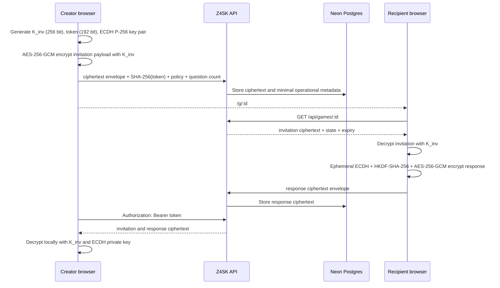

# Cryptographic design / Diseño criptográfico

[English](#english) · [Español](#español) · [Security policy](../SECURITY.md) · [Live audit](https://z4sk.vercel.app/audit) · [Machine-readable proof](https://z4sk.vercel.app/api/privacy-proof)

## English

### Scope and security goals

Z4SK uses browser-side authenticated encryption for both invitation content and responses. The goal is that a disclosure of the active database or a provider recovery copy does not reveal display names, questions, settings, respondent names or answers without the user-held URL-fragment secrets.

This is a bearer-link system, not an account system. Possession of a complete link grants a capability. **Sharing the complete invitation link is equivalent to sharing a password.** The public invitation link grants decryption of the invitation and permission to submit; the creator link additionally grants dashboard authorization and response decryption.

### Protocol

#### Invitation envelope

- Algorithm: AES-256-GCM through the Web Crypto API.
- Key: 32 cryptographically random bytes generated in the creator browser.
- IV: 12 random bytes per invitation.
- Additional authenticated data: the versioned context string `z4sk-invitation-v1`.
- Encrypted payload: creator and recipient display names, title, locale, level, questions, feature settings, pack, library version, client creation time and response ECDH public key.
- Key transport: base64url in the `#invite=` fragment of the invitation and creator links. The key is never included in an HTTP request by normal browser navigation.

#### Response envelope

- Key agreement: creator static ECDH P-256 public key + recipient ephemeral ECDH P-256 private key.
- Key derivation: HKDF-SHA-256 with a random 32-byte salt and a versioned context.
- Content encryption: AES-256-GCM with a random 12-byte IV.
- Encrypted payload: respondent display name, answers, reactions and the double-blind match choice.
- The creator's ECDH private key remains in the creator-link fragment.

#### Authorization and deletion

- Creator access token: 24 random bytes; only its SHA-256 hash is stored.
- Public invitation ID: 16 random bytes for new invitations.
- Recipient deletion token: 24 random bytes; only its hash is stored.
- View once: a single database statement locks the row, returns ciphertext and deletes the active invitation graph before the browser decrypts it.
- Expiry: access is rejected at the exact deadline; a daily task and opportunistic cleanup remove expired active rows.

### Server-visible data

| Category | Server-readable | Encrypted / absent |
| --- | --- | --- |
| Invitation | random ID, ciphertext envelope, question count, expiry, view-once flag, opened/closed state, timestamps | names, title, questions, locale, level, settings, response public key |
| Response | ciphertext envelope, invitation ID, submission time, single-use state | respondent name, answers, reactions, match choice |
| Authorization | SHA-256 token hashes; raw creator token is transiently processed in the `Authorization` header | invitation key and response private key never enter the API |
| Abuse/operations | reason category, timestamps, approximate country, rate-limit HMAC, request path/infrastructure logs | raw IP is not stored by application code; bodies and URL fragments are not logged by application code |

### Publicly auditable evidence

- Invitation implementation: [`app/lib/invitation-crypto.ts`](../app/lib/invitation-crypto.ts)
- Response implementation: [`app/lib/response-crypto.ts`](../app/lib/response-crypto.ts)
- Creation endpoint: [`app/api/games/route.ts`](../app/api/games/route.ts)
- Data-flow verifier: [`scripts/verify-e2ee.mjs`](../scripts/verify-e2ee.mjs)
- Live schema/data checks: [`app/api/privacy-proof/route.ts`](../app/api/privacy-proof/route.ts)
- Migration history: [`scripts/migrations.mjs`](../scripts/migrations.mjs)
- CI workflow: [`.github/workflows/ci.yml`](../.github/workflows/ci.yml)

The live proof is a self-audit, not an external certification. A reviewer can compare the public production commit, workflow result, endpoint implementation and runtime JSON evidence. A future malicious deployment remains an explicit trust boundary because browser JavaScript controls encryption.

### Legacy compatibility

Invitations created before the encrypted-invitation migration may be served through the legacy readable structure until they expire. New creation requests are accepted only with an authenticated encrypted invitation envelope. The live proof reports any active legacy invitation rather than hiding it.

## Español

### Objetivo y modelo de acceso

Z4SK cifra en el navegador tanto el contenido de la invitación como las respuestas. El objetivo es que una filtración de la base activa o de una copia de recuperación no revele nombres, preguntas, ajustes ni respuestas sin los secretos que permanecen en los enlaces de los usuarios.

No es un sistema de cuentas: es un sistema de capacidades mediante enlaces. **Compartir el enlace completo es como compartir una contraseña.** El enlace público permite descifrar la invitación y responder; el enlace del creador añade autorización para el panel y la clave privada para descifrar respuestas.

### Qué ocurre al crear y responder

1. El navegador del creador genera una clave aleatoria AES de 256 bits, un token de acceso de 192 bits y un par ECDH P-256.
2. Cifra localmente nombres, preguntas, ajustes y la clave pública ECDH mediante AES-256-GCM.
3. La API recibe únicamente el sobre cifrado, el hash SHA-256 del token, el número de preguntas y la política operativa de caducidad/lectura única.
4. La clave AES queda en `#invite=`. El fragmento no forma parte de la petición HTTP normal.
5. El destinatario descarga el texto cifrado, lo descifra en su navegador y cifra su respuesta con ECDH P-256, HKDF-SHA-256 y AES-256-GCM.
6. El panel descarga ambos textos cifrados y los descifra localmente con los secretos de su propio fragmento.

### Límites

La infraestructura sigue viendo identificadores aleatorios, fechas, estado, caducidad, número de preguntas, rutas y metadatos de red. Quien obtenga un enlace completo obtiene su capacidad. Un navegador, extensión, dispositivo, portapapeles, captura o despliegue malicioso puede revelar el contenido. El cifrado no elimina lo que una persona ya haya visto o copiado, ni ofrece recuperación de un enlace perdido.

La página pública [z4sk.vercel.app/audit](https://z4sk.vercel.app/audit) reúne el diseño, el código relevante y la evidencia en vivo. El endpoint [`/api/privacy-proof`](https://z4sk.vercel.app/api/privacy-proof) es una autoauditoría generada por el propio servicio, no una certificación independiente.
